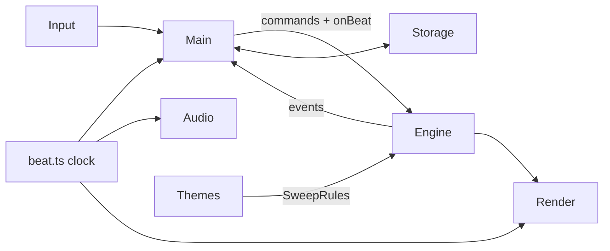

# BEAT//BLOCK v2 — Product + Technical PRD

**Status:** Draft for Nabil's approval · **Date:** 2026-11-07 · **Builds on:** [`PRD.html`](PRD.html) (v1, shipped) and v1.1 (splash + onboarding)
**Scope:** four gameplay twists — Daily Drop, beat-timed drops, special blocks, per-skin sweep modifiers.

> Made with the `game-tech-prd` skill. There is no separate GDD for v2, so the design requirements are written here and given `GDD-*` IDs (§2). Estimates are estimates.

---

## 1. Summary

**Goal:** give players a reason to come back daily and make the rhythm matter, without breaking the v1 rules that make the game feel fair.

| Twist | Player-facing promise | Pillar it serves |
|---|---|---|
| **Daily Drop** | One seeded run a day, same pieces for everyone, shareable result | Return + share |
| **Beat-timed drops** | Hard-drop on the beat for a multiplier | Rhythm actually matters |
| **Special blocks** | Bomb, Chain and Wild cells add planning depth | Depth without new controls |
| **Skin modifiers** | Each skin changes one sweep rule, so skin-ups feel like new levels | Progression / variety |

**Non-goals:** online leaderboards or accounts (Daily stays local + share text), new controls, new piece shapes, monetisation, a backend.

**Success metrics (estimates to validate in playtest):**
- Median run length up ≥ 20% vs v1 (local stats, 10 playtest sessions)
- ≥ 30% of on-beat-eligible hard drops land on-beat for a returning player by run 5
- Daily Drop played on ≥ 3 of 7 days by Nabil's test group
- Zero regressions of the v1 "must not regress" rules (AGENTS.md)

---

## 2. Requirements and traceability

### 2.1 Design requirements (GDD IDs)

**Daily Drop**
- **GDD-DAILY-01** One run per calendar day (local date) uses a seed derived from the date. Same date ⇒ same piece sequence for every player.
- **GDD-DAILY-02** Unlimited retries; the day's best score is kept separately from the Endless best.
- **GDD-DAILY-03** Share text includes date, score, time, and a 5-cell emoji-free "beat strip" (e.g. `▮▮▯▮▮`) showing on-beat drop rate. *(No emoji: house rule.)*
- **GDD-DAILY-04** Daily always starts on a fixed skin rotation for that day (so modifiers are identical for everyone).
- **GDD-DAILY-05** Home shows a streak counter (consecutive days played).

**Beat-timed drops**
- **GDD-BEAT-01** A beat clock drives the music; hard drops within ±90 ms of a beat (estimate, tune in playtest) are **on-beat**.
- **GDD-BEAT-02** On-beat drops build a beat multiplier (×1.0 → ×2.0, +0.1 per consecutive on-beat drop); an off-beat hard drop resets it. Soft drops and gravity locks don't affect it.
- **GDD-BEAT-03** Visual pulse on the board edge and the Next box marks each beat; "ON BEAT" pop on success.
- **GDD-BEAT-04** Accessibility: a setting widens the window to ±150 ms; "Reduced motion" keeps the pulse as a colour change, not a scale.
- **GDD-BEAT-05** Audio-latency calibration screen in Settings (tap along to 8 beats → stored offset).

**Special blocks**
- **GDD-SPEC-01** About 1 in 12 pieces (estimate) carries one special cell on one of its four cells. It keeps its colour, so it still counts toward 2×2 squares.
- **GDD-SPEC-02** **Bomb**: when cleared by the sweep, also clears every cell in a 3×3 around it, regardless of colour.
- **GDD-SPEC-03** **Chain**: when cleared, also clears every connected cell of the same colour, even ones not in a square.
- **GDD-SPEC-04** **Wild**: counts as either colour for square matching; renders as a striped/symbol cell (solid fills, no gradients).
- **GDD-SPEC-05** Specials appear from skin 2 (after the first 12 squares), so new players learn the base rule first.
- **GDD-SPEC-06** Each special has a distinct symbol when "Colour symbols" is on.

**Skin sweep modifiers**
- **GDD-MOD-01** Each skin has at most one modifier, announced on skin-up ("ACID — sweep runs backwards").
- **GDD-MOD-02** Proposed set (tune in playtest):
  | Skin | Modifier |
  |---|---|
  | Rave | None (baseline) |
  | Acid | Sweep runs right → left |
  | Sunset Bass | Sweep pauses one beat at mid-board |
  | Laser | Two sweep lines, half-board apart, each at 60% speed |
  | Deep House | Gravity slower, sweep faster |
  | Vapor | Special blocks twice as common (next piece always shown) |
- **GDD-MOD-03** Modifiers change rules only during that skin; the board carries over unchanged.
- **GDD-MOD-05** No modifier may hide the next-piece preview (players must be able to plan).
- **GDD-MOD-04** Endless can turn modifiers off in Settings ("Classic sweep") for purists.

### 2.2 Traceability

| GDD ID | Tech requirement | Module | Test | Status |
|---|---|---|---|---|
| DAILY-01 | TR-01 `seedForDate(yyyy-mm-dd)` → FNV-1a 32-bit hash; local date | `engine/rng.ts` | unit: same date → same 100 pieces | Planned |
| DAILY-02, 05 | TR-02 Profile schema v3: `daily: { date, best, timeMs, streak, lastPlayed }` + migration | `storage.ts` | unit: v2 → v3 migration keeps records | Planned |
| DAILY-03 | TR-03 `shareMessage` gains a daily variant | `share.ts` | unit: snapshot of text | Planned |
| DAILY-04 | TR-04 `skinFor` takes a starting index from the seed in Daily mode | `themes.ts` | unit | Planned |
| BEAT-01 | TR-05 **Beat clock**: one source of truth for beat time, driven by `AudioContext.currentTime` (falls back to `performance.now()` when muted) | new `src/beat.ts` | unit: on-beat window math | Planned |
| BEAT-02 | TR-06 Engine accepts `HARD_DROP` with `onBeat: boolean`; multiplier lives in `Game`, not UI | `engine/game.ts` | unit: streak + reset | Planned |
| BEAT-03, 04 | TR-07 Renderer pulse driven by beat phase; no RNG use | `render.ts` | manual + screenshot | Planned |
| BEAT-05 | TR-08 Calibration sheet; offset stored in settings | `main.ts`, `storage.ts` | manual | Planned |
| SPEC-01, 05 | TR-09 Specials rolled from a **second RNG stream** so piece-type odds stay exactly 1/7 | `engine/pieces.ts`, `rng.ts` | unit: type distribution unchanged with specials on | Planned |
| SPEC-02–04 | TR-10 Board cells become `colour | flags<<4` in the `Uint8Array`; match + clear honour flags | `engine/game.ts` | unit per special | Planned |
| SPEC-06 | TR-11 Symbols per special | `render.ts` | screenshot | Planned |
| MOD-01–03 | TR-12 `Theme.modifier` field; engine reads a `SweepRules` object, set on skin change | `themes.ts`, `engine/game.ts` | unit per modifier | Planned |
| MOD-04 | TR-13 Setting `classicSweep` | `storage.ts` | unit | Planned |

---

## 3. Platforms and targets

Unchanged from v1: installable PWA, mobile portrait first, desktop keyboard, offline play. Min spec: iPhone SE (2nd gen) Safari, mid-range Android Chrome. Board stays 10×16.

## 4. Stack

Vite + TypeScript, plain DOM, Canvas 2D, Web Audio, Vitest, Netlify. No new runtime dependencies. *(Hard to reverse: none of v2 adds one.)*

## 5. Architecture

- **Beat clock is the key new piece.** Today the sweep is time-based and the music runs separately. v2 makes `beat.ts` the one clock: audio schedules from it, input stamps drops against it, renderer pulses from it. The sweep stays time-based (matches v1 feel); only drop timing and visuals use beats.
- Engine stays DOM-free and deterministic: `onBeat` is decided outside and passed in, so tests don't need audio.
- Rendering never consumes RNG (v1 rule). Specials use their own RNG stream.

## 6. Data and persistence

- Profile schema **v2 → v3**: adds `daily`, `settings.beatWindow`, `settings.audioOffsetMs`, `settings.classicSweep`. Migration fills defaults; existing records untouched.
- Tuning values (beat window, multiplier step, special rate, modifier params) live in `CONFIG` / `THEMES`, not inline.

## 7. Networking

None. Daily Drop is offline-safe: seed comes from the local date.

## 8. Content pipeline

No new assets: specials and pulses are drawn in code. Sounds for bomb/chain are synthesised in `audio.ts`.

## 9. Performance budgets

| Budget | Target | How measured |
|---|---|---|
| Frame time, min-spec phone | ≤ 16.6 ms p95 during a Laser double sweep + bomb clear | Chrome DevTools performance trace, 60 s run |
| Beat accuracy | Pulse and audio drift ≤ 10 ms over 5 min | log beat timestamps vs `AudioContext.currentTime` |
| JS bundle | ≤ 55 kB gzip (v1.1 is 15.5 kB) | `npm run build` output |
| Allocation | No per-frame allocations in engine | heap snapshot over 60 s |

## 10. Quality strategy

- Vitest for every TR marked unit above; keep all 20 existing tests green.
- Seeded replay test: a fixed seed + input script produces the same score before and after v2 with specials and modifiers **off** (proves no regression).
- Playtest: Nabil + 3 people, 15 minutes each, after S2 and S4.

## 11. Build and release

Branch per sprint → push to `main` at sprint completion → Netlify auto-deploy. Bump `public/sw.js` `VERSION` each release. Rollback: redeploy previous Netlify build.

## 12. Privacy

All data stays on device. Share text holds only score, time, date.

## 13. Risks

| Risk | Likelihood | Impact | Mitigation / spike | Owner | Due |
|---|---|---|---|---|---|
| Bluetooth/iOS audio latency makes beat timing feel wrong | High | High | Spike in S1: measure on 3 devices; calibration screen (BEAT-05) | Claude | S1 |
| Specials + modifiers stack into chaos | Med | High | Specials from skin 2; one modifier per skin; playtest after S4 | Nabil | S4 |
| Wild cells break the match algorithm | Med | Med | Unit tests on every 2×2 permutation with a wild | Claude | S3 |
| Daily seed differs by time zone | Med | Low | Local date by design; document it in Help | Claude | S1 |
| Schema migration loses records | Low | High | Migration unit test with a real v2 profile fixture | Claude | S1 |

## 14. Milestones (estimate: 4 sprints)

| Sprint | Scope | Exit criteria |
|---|---|---|
| S1 | Beat clock, latency spike, schema v3, Daily seed + Home card live | Daily playable; migration test green |
| S2 | Beat-timed drops, multiplier, pulse, calibration | Playtest 1 done |
| S3 | Special blocks (Bomb, Chain, Wild) | All special unit tests green |
| S4 | Skin modifiers, Classic sweep toggle, Daily share + streak | Playtest 2 done; release |

## 15. Definition of Done

- `npm test` and `npm run build` pass with zero new errors or warnings
- Acceptance criteria for linked GDD/TR IDs pass; logic has unit tests
- Player-visible change run in a browser and evidenced (screenshot or clip)
- Within §9 budgets on min-spec phone
- No hard-coded tuning values; works on touch and keyboard
- AGENTS.md "must not regress" rules still hold (1/7 RNG, no gradients, render never uses RNG, 10×16)
- PRD/AGENTS.md updated if behaviour changed; README updated
- Pushed to `main`; Change Log row in Notion

## 16. Open questions

1. ~~Daily attempts~~ **Decided 2026-11-07:** unlimited retries; day's best counts.
2. ~~Beat × combo~~ **Decided 2026-11-07:** they stack, capped at ×6 total.
3. ~~Vapor hidden preview~~ **Decided 2026-11-07:** dropped. The next piece is always shown so players can plan. Vapor now doubles the special-block rate.
4. Online daily leaderboards later? Needs a backend and breaks the "no account" stance. *Still open.*
